# MediaDeck

[](https://github.com/okkysatria/MediaDeck/releases/latest/download/MediaDeck.apk)

MediaDeck is an Android app for browsing and playing media stored in device folders or Samba (SMB) shares. It combines a comic reader, photo and video gallery, and movie player. The interface is available in English and Bahasa Indonesia. Library data and viewing progress are stored locally.

## Screenshots

| Comics library | Gallery library | Movies library |
|---|---|---|
| 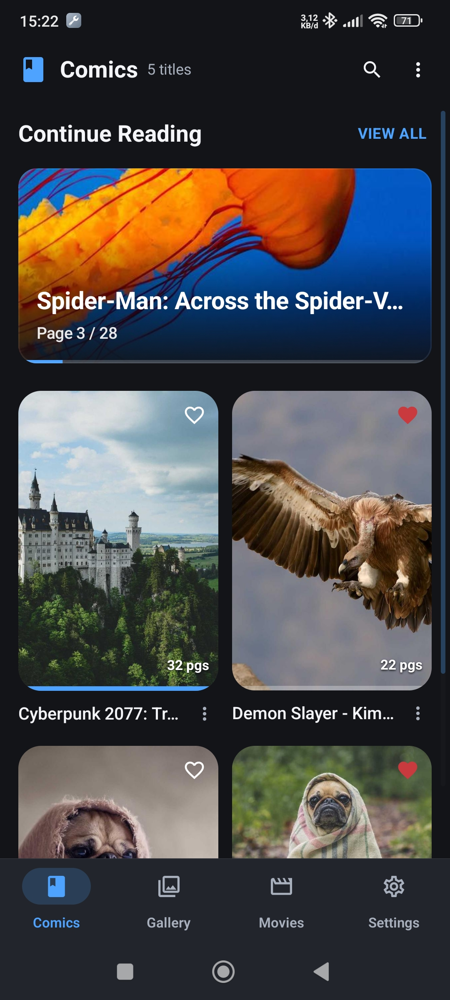 | 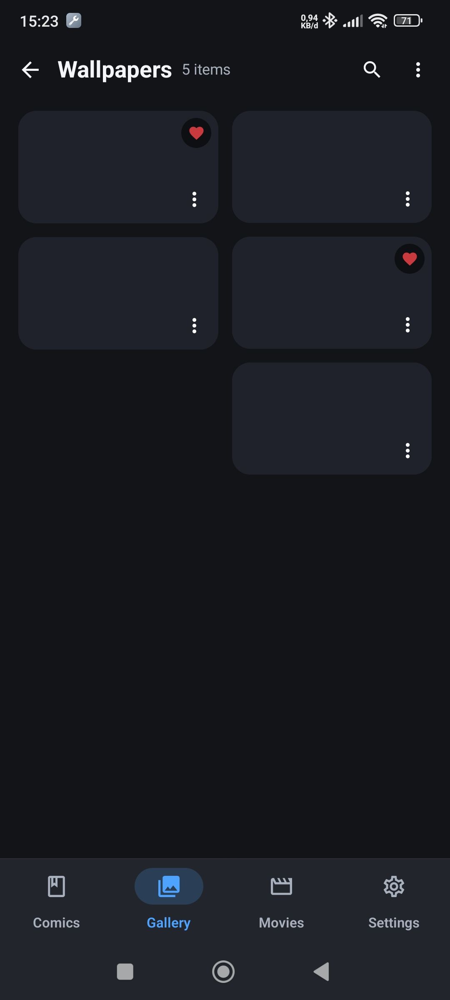 | 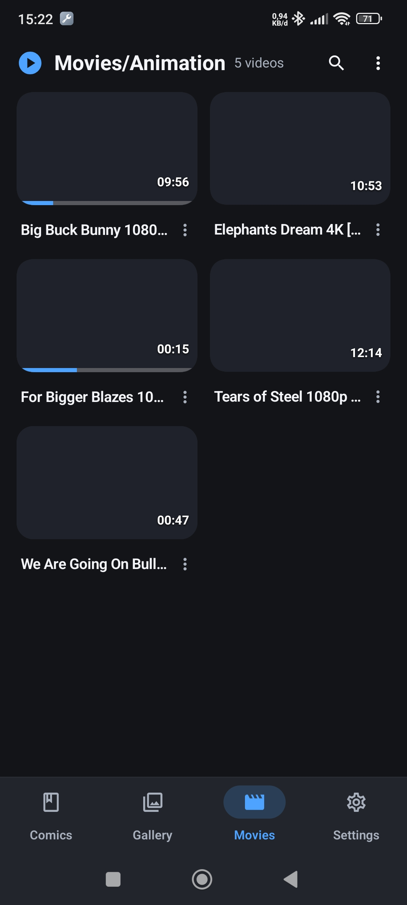 |
| Comic reader (vertical) | Comic reader (double-page) | Photo viewer |
| 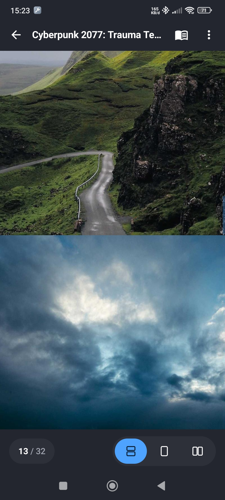 | 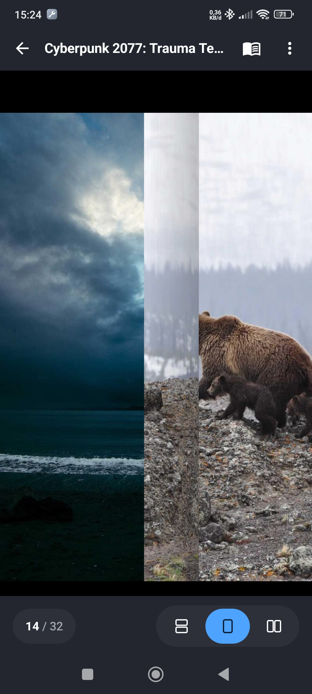 | 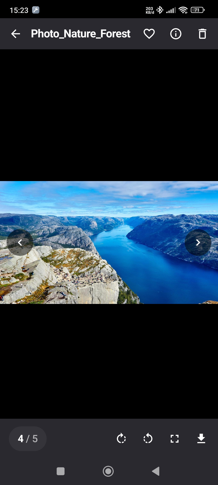 |
| Video player | Comics options | General settings |
| 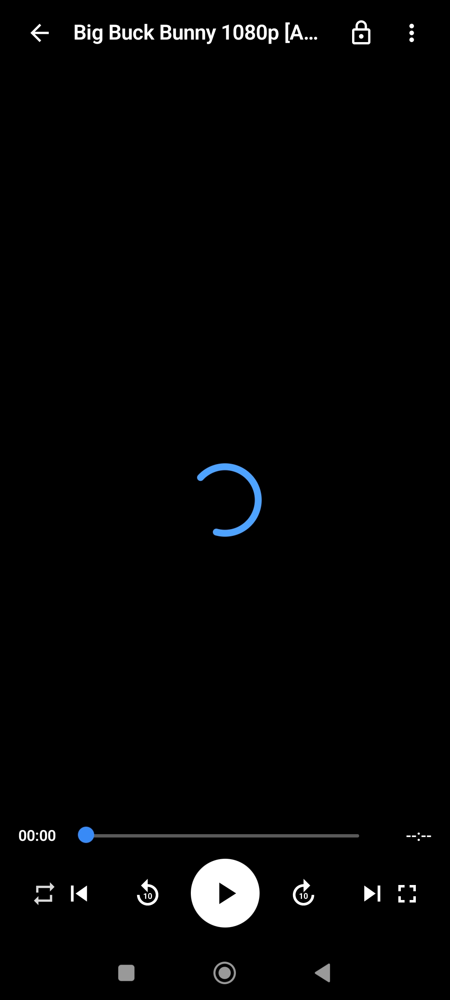 | 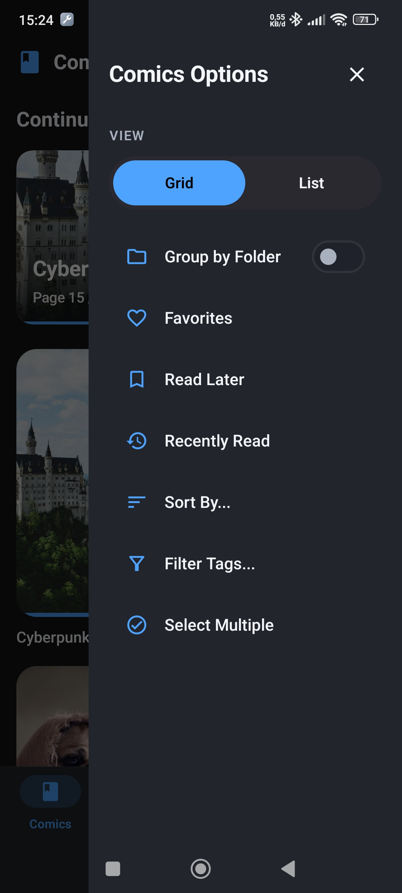 | 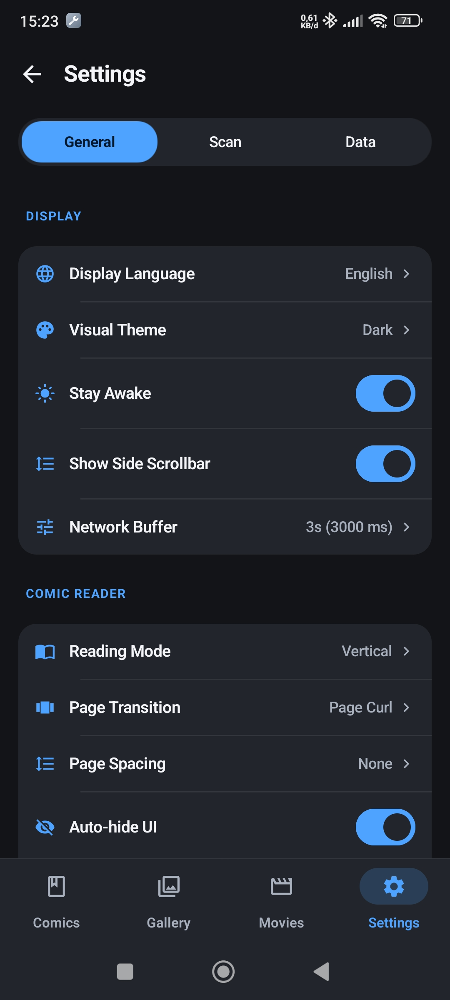 |
| Scan settings | Data settings | |
| 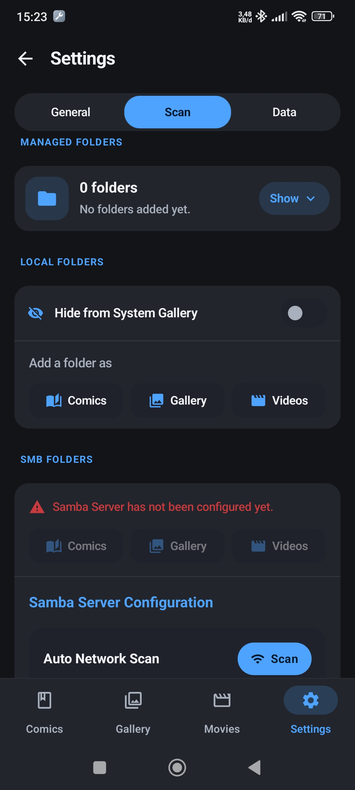 | 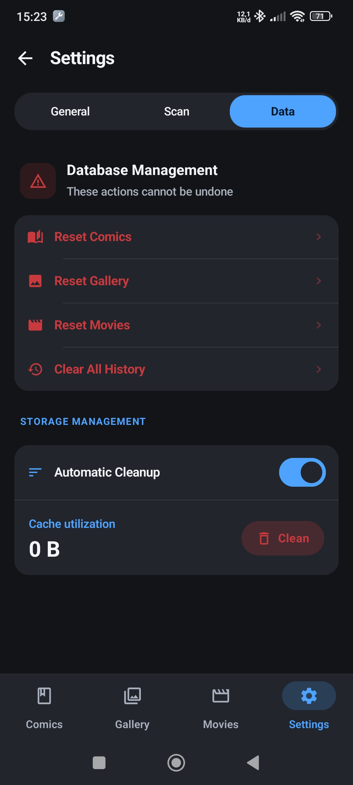 | |

## Features

### Comics

- Scan folders of images and CBZ/ZIP archives from local storage or SMB shares.
- Read vertically, one page at a time, or in double-page spreads.
- Save reading progress and navigate through pages.

### Gallery

- Browse photos and videos in grid or list layouts and group items by folder.
- Search, filter, and sort the scanned library.
- View images full-screen with zoom and play videos.
- Generate and cache thumbnails for faster browsing.

### Movies

- Scan and play local or SMB-hosted videos, streaming network files on demand.
- Resume playback and review playback history.
- Select subtitles, use picture-in-picture, and control playback with gestures.

### SMB libraries

- Configure a Samba host and connection details in Settings.
- Browse available shares and folders, then scan a selected location as Comics, Gallery, or Movies.
- SMB media requires the server to be reachable on the network during scanning and playback.

### Scanning and preferences

- Run media scans and thumbnail generation in a foreground service with visible progress.
- Choose English or Bahasa Indonesia, light/dark/system theme, and reader, gallery, and player preferences.
- Store library metadata, settings, and reading or playback progress in a local Room database.

### Supported media

- **Images:** JPG, JPEG, PNG, WebP, GIF, BMP, HEIC, HEIF
- **Comic archives:** CBZ and ZIP containing image pages
- **Videos:** 3G2, 3GP, ASF, AVI, F4V, FLV, M2T, M2TS, M2V, M4V, MKV, MOV, MP4, MPE, MPEG, MPG, MPV, MTS, MXF, OGV, TS, VOB, WebM, WMV

Video playback also depends on the codecs available on the Android device.

## Project structure

```text
app/src/main/java/com/mediadeck/app/
├── MainActivity.kt                 Activity and app entry point
├── MediaDeckApp.kt                 Application setup
├── data/                           Room database, entities, DAOs, repository
│   ├── comic/                      Comic data and DAO
│   ├── gallery/                    Gallery data and DAO
│   ├── movie/                      Movie data and DAO
│   └── settings/                   App settings and scanned folders
├── di/                             Database and repository dependency injection
├── service/                        Background media scanning service
├── ui/
│   ├── components/                 Reusable Compose UI and media components
│   ├── navigation/                 App navigation
│   ├── screens/                    Comic, gallery, movie, player, and settings screens
│   │   └── settings/               Settings sections and SMB browser
│   └── theme/                      Compose colors, typography, and theme
├── util/
│   ├── cache/                      Disk cache helpers
│   ├── i18n/                       English and Indonesian localization
│   ├── media/                      Media identity, formatting, and thumbnails
│   ├── scan/                       Local scanning and media processing
│   ├── smb/                        SMB connections, scanning, and content provider
│   └── zip/                        ZIP/CBZ reading and page extraction
└── viewmodel/                      Screen state and application actions
```

Android resources and the manifest are under `app/src/main`. Local JVM/Robolectric tests are under `app/src/test`; instrumented tests are under `app/src/androidTest`.

## Technology and requirements

- Kotlin 2.4.20, Android Gradle Plugin 9.4.1, and Gradle Wrapper 9.8.2
- Jetpack Compose with Material 3, Navigation Compose, Lifecycle ViewModel, and Kotlin Coroutines
- Room 2.8.5 for library data and settings
- Hilt for dependency injection
- Coil for image loading and thumbnails
- AndroidX Media3 for video playback
- jcifs-ng for SMB access
- Android SDK Platform 37; minimum Android version API 24 (Android 7.0)
- JDK 25 for the configured Gradle daemon; Java source and target compatibility are 17

For local folders, the app uses Android's system folder picker and the user grants access to the selected location. Network access is needed for SMB browsing and streaming. Background scanning uses a foreground service and may show a notification.

## Build and test

Build a debug APK:

```bash
./gradlew :app:assembleDebug
```

On Windows, run `gradlew.bat :app:assembleDebug`.

The debug APK is written to `app/build/outputs/apk/debug/app-debug.apk`. The `assembleDebug` task also copies it to `app/build/outputs/apk/MediaDeck/MediaDeck.apk`.

Run local unit and Robolectric tests:

```bash
./gradlew :app:testDebugUnitTest
```

On Windows, run `gradlew.bat :app:testDebugUnitTest`.

Run instrumented tests on a connected Android device or emulator:

```bash
./gradlew :app:connectedDebugAndroidTest
```

On Windows, run `gradlew.bat :app:connectedDebugAndroidTest`.
